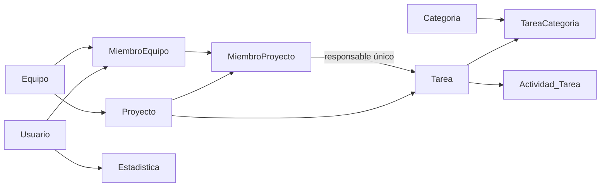

# Análisis de la base de datos para equipos

Actualización 2026-11-14: este análisis histórico precede a la implementación. El usuario confirmó participantes seleccionados por tarea, finalización cuando todos marcan su parte y recompensa completa por asignado. La migración 003 y las transacciones implementan esas garantías; ver [decisiones-teams.md](decisiones-teams.md) y [contrato de equipos](../backend/docs/equipos.md).

Fecha: 2026-11-10. Fuente: `database/BD_My_Daily_Routine.sql`, contrastada con los modelos, almacenes y pantallas Flutter actuales. Es una revisión estática del script; no se conectó a una instancia SQL ni se ejecutaron sus instrucciones. No se modificó el esquema ni se implementó la función colaborativa.

## Objetivo confirmado

Seleccionar usuarios para formar equipos, crear proyectos dentro de un equipo y elegir qué miembros participan. El usuario confirmó el 2026-11-10 que las recompensas se entregan al completar cada tarea y que cada participante recibe los puntos completos de las categorías correspondientes, sin repartirlos entre personas. Todo participante del proyecto debe pertenecer al equipo propietario; pertenecer únicamente a un equipo externo no permite incorporarlo.

Queda por precisar si cada tarea tendrá una selección de participantes o si todos los participantes del proyecto recibirán sus puntos. La política de reapertura y los cambios de miembros siguen pendientes; las medidas transaccionales de este documento son propuestas técnicas, todavía no implementadas.

## Lo que ya soporta el esquema

El archivo contiene diez tablas y su sintaxis apunta a MySQL/MariaDB (`AUTO_INCREMENT`, `USE`). No identifica motor ni versión de despliegue.

- `MiembroEquipo` permite varios usuarios por equipo y evita duplicar `(idEquipo, idUsu)`.
- `MiembroProyecto` permite seleccionar un subconjunto del equipo y evita duplicar `(idProyecto, idMiembro)`.
- `Proyecto` pertenece a un equipo y tiene una categoría principal; `TareaCategoria` permite varias categorías por tarea.
- `Tarea.idProyecto` nulo permite conservar tareas personales.
- `Estadistica` usa `idUsu` como PK/FK: como máximo un registro de estadísticas por cuenta. La FK no crea automáticamente ese registro; el backend deberá inicializarlo.
- `Actividad_Tarea` registra aportes con autor y porcentaje; puede servir de historial de actividad, pero no es un registro de puntos otorgados.

## Problemas que deben resolverse antes de conectar la app

| Prioridad | Hallazgo | Consecuencia y preparación propuesta |
| --- | --- | --- |
| Alta | Las FK de `MiembroProyecto` comprueban proyecto y miembro por separado. | Permiten asociar una pertenencia del equipo A a un proyecto del equipo B, contrario a la regla confirmada. Validar igualdad de equipo en el backend y estudiar claves compuestas que la garanticen también en SQL. Si el usuario pertenece a ambos equipos, debe usarse su pertenencia al equipo del proyecto. |
| Alta | `Tarea.responsable_id` referencia `MiembroProyecto`, pero Flutter guarda `miembro.usuarioId` en ese campo. | Los enteros pertenecen a dominios distintos. Definir un contrato explícito, por ejemplo `responsableMiembroProyectoId`, y convertir los modelos antes de conectar; no enviar directamente el valor actual. |
| Alta | No se exige que el responsable pertenezca al mismo proyecto de la tarea. | Puede asignarse un responsable de otro proyecto o uno de proyecto a una tarea personal. Validar esa coherencia y reforzarla con relación compuesta según el diseño final. |
| Alta | Solo existe un responsable por tarea. | Sirve si el trabajo y recompensa son para todos los participantes del proyecto. Si cada tarea admite varios colaboradores específicos, hace falta una relación `ParticipanteTarea`; el responsable coordinador puede seguir siendo único. |
| Alta | No hay registro de recompensas ni clave de unicidad para su entrega. | Completar dos veces, reintentar una petición o recibir dos peticiones simultáneas podría duplicar puntos. Añadir un evento de finalización y movimientos por destinatario/categoría, con unicidad y una transacción. |
| Alta | El progreso colaborativo no está conectado a las estadísticas. | `TeamTrabajoStore.actualizarProgreso` solo cambia el porcentaje. No completa `NuevaTarea`, no otorga puntos y conserva un estado paralelo al booleano `completada`. Unificar la finalización autorizada en el servidor. |
| Media | `Estadistica` usa `INT`, pero Flutter divide 5, 10 o 15 puntos entre categorías. | Por ejemplo, 5/3 produce fracciones. Elegir precisión decimal y regla de redondeo, o cambiar explícitamente las reglas para usar enteros. No truncar silenciosamente. |
| Media | Faltan campos colaborativos ya usados en Flutter. | `TareaTeam` tiene `peso`, `progreso`, `archivada` y fechas de trabajo. Decidir cuáles se guardan en `Tarea` y cuáles se calculan desde actividad; el porcentaje de una actividad no define por sí solo el estado actual. |
| Media | Varios IDs principales no tienen generación automática. | `Usuario`, `Equipo`, `Proyecto`, `Tarea` y `Categoria` requieren un ID explícito. Elegir generación definitiva en backend/BD; los negativos de Flutter siguen siendo temporales, no IDs definitivos. |
| Media | `rol` es texto libre y el creador del equipo no tiene pertenencia garantizada. | Restringir roles válidos y crear equipo + pertenencia de su creador en la misma transacción. Los permisos deben verificarse en servidor, no solo en la pantalla. |
| Media | No hay datos iniciales de categorías ni códigos estables. | Definir códigos como `educacion`, `salud`, `finanzas`, `disciplina`; educación aporta inteligencia. No depender del nombre visible ni de IDs locales de un enum. |
| Media | No se definen reglas completas de fechas, rangos o bajas. | Revisar inicio/fin, progreso y estadísticas en rango; definir archivado y conservación del historial al retirar miembros. No añadir borrados en cascada que eliminen recompensas sin decidirlo. |

Otras diferencias: `Proyecto.fechaFin` puede ser nulo en SQL pero es obligatorio en Dart. Las preferencias de categorías activas de `Estadisticas` no están en la tabla SQL. `Actividad_Tarea.usuarioid` requiere comprobar que el autor esté autorizado para esa tarea/proyecto. `passwordUsu` debe almacenar un hash calculado por el backend, nunca la contraseña local en claro. El campo `Usuario.foto` es solo una columna disponible: no autoriza a guardar las imágenes enviadas al análisis del avatar.

## Aura, categorías y puntos actuales

La app utiliza cuatro estadísticas: inteligencia, salud, finanzas y disciplina. En el inicio, el indicador con el icono de aura muestra `estadisticas.general`: el promedio de las categorías activas. **Aura no es actualmente una quinta bolsa de puntos**, ni existe como columna SQL. La categoría `educacion` de una tarea aporta a inteligencia.

Hoy se asignan 5/10/15 puntos por prioridad baja/media/alta, divididos entre las categorías de la tarea, con límite de 100 por estadística. Solo se acredita al `usuarioId` propietario; no a un conjunto de participantes. Además, en las tareas personales, desmarcar y volver a completar puede volver a sumar porque no existe historial de acreditaciones. Conviene resolver la duplicación con un mecanismo común para tareas personales y de proyecto.

## Diseño recomendado para la siguiente etapa (todavía no implementado)

1. Mantener `Equipo → Proyecto → Tarea` y las dos tablas de pertenencia existentes; no es necesario rehacer la base.
2. Definir participantes por proyecto y, únicamente si el producto lo necesita, por tarea. Congelar la lista de beneficiarios al completar, para que agregar o retirar miembros después no cambie recompensas pasadas.
3. Crear un evento único de finalización por tarea, conforme al disparador confirmado. Guardar actor, fecha, versión de regla de puntos y beneficiarios; acreditar a cada uno la recompensa completa.
4. Registrar movimientos con usuario, categoría, puntos y evento. Una unicidad `(evento, usuario, categoria)` evita duplicados internos; además, el evento debe ser único para la finalización recompensable del origen. El UUID de una petición por sí solo no evita duplicar el mismo trabajo con otro UUID.
5. Dentro de una transacción: autenticar, comprobar rol y pertenencias, bloquear/validar el estado, registrar la finalización y movimientos, actualizar estadísticas y confirmar. Ante una repetición, devolver la recompensa existente. Un fallo debe revertir toda la entrega.
6. Para reabrir tareas, definir si se revierte la recompensa o se conserva sin permitir otra entrega. No conceder puntos por cada actualización de porcentaje ni confiar en cantidades enviadas por Flutter.

Ejemplo del acuerdo: si una tarea concede **5 puntos de finanzas** y tiene tres participantes beneficiarios, **cada uno recibe 5 puntos de finanzas**. El número de personas no reduce la recompensa individual. Conservando el cálculo actual entre categorías, una tarea de prioridad media con educación y salud otorgaría **5 de inteligencia y 5 de salud a cada participante**. Ese reparto entre categorías es distinto del reparto entre personas, que el usuario descartó. El límite actual de 100 por estadística puede limitar el incremento visible; conviene distinguir la recompensa registrada del saldo resultante.

## Orden de trabajo sugerido

1. Precisar participantes por tarea frente a participantes del proyecto, y definir reapertura, cambios de miembros y redondeo. El disparador por tarea y la recompensa completa por participante ya están acordados.
2. Preparar una migración versionada con restricciones, categorías y registro de recompensas; conservar este SQL original como referencia. Confirmar motor/versión antes de ejecutar.
3. Incorporar conexión a BD y autenticación real al backend. Actualmente `backend/app.py` solo expone el análisis de fotos; no hay API de usuarios, equipos, proyectos o tareas ni conexión SQL.
4. Implementar búsqueda de usuarios, pertenencias, permisos y finalización transaccional.
5. Conectar Flutter y probar aislamiento entre equipos, responsable de otro proyecto, doble finalización, peticiones simultáneas, cambios de miembros, reapertura y redondeo.

Esta revisión prepara la implementación. No se crearon tablas nuevas, no se ejecutó el script y no se cambió el reparto de puntos en la aplicación.
